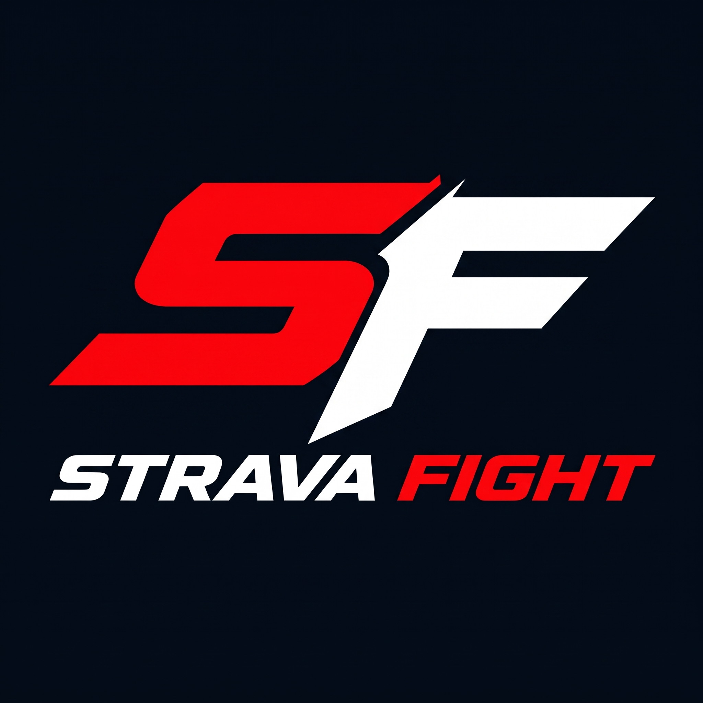

# STRAVA FIGHT 🥋🥊
> **Esforço que transforma. Luta que evolui.**

Rede social global e ecossistema de gestão e negócios para artes marciais, lutas, esportes de combate e atividades físicas.



---

## 🎖️ STATUS DO PROJETO

| Categoria | Status |
|-----------|--------|
| **Build de Produção** | ✅ APROVADO |
| **TypeScript** | ✅ SEM ERROS |
| **Testes Automatizados** | ✅ 11/11 PASSANDO |
| **Segurança** | ✅ RLS ATIVO + XSS PROTEÇÃO |
| **Performance** | ✅ OTIMIZADO (Code Splitting + Lazy Load) |
| **Supabase Migrations** | ✅ 4 MIGRATIONS PRONTAS |
| **Deploy Vercel** | ⚠️ AGUARDANDO CONFIGURAÇÃO |
| **Domínio** | ⚠️ stravafight.com.br (AGUARDANDO DNS) |

---

## ⚡ Tecnologias

- **Front-end:** React 19, TypeScript, Vite, Tailwind CSS v4, Lucide Icons, Motion
- **Back-end & Nuvem:** Supabase (PostgreSQL 15+, Supabase Auth, Supabase Storage, Realtime)
- **Hospedagem & Deploy:** Vercel (SPA com rewrites nativos em `vercel.json`)
- **Domínio Oficial:** `https://stravafight.com.br`

---

## 🎯 Módulos Integrados

1. **Feed & Comunidade:** Publicações com dados de treino em tatame (rounds, calorias, intensidade, XP), histórias (stories), vídeos verticais (reels), curtidas e comentários.
2. **SF Activity:** Editor dinâmico de sobreposição de métricas para fotos de treino, com stickers SVG de modalidades marciais (Boxe, Muay Thai, Jiu-Jitsu, MMA, Funcional), movimentação, escala e rotação em canvas interativo.
3. **SF Academy:** Plataforma completa de gestão de academias e equipes: cadastro de alunos, fichas com responsáveis legais para menores, grade de turmas e horários, lista de chamada diária, controle de mensalidades, fluxo de caixa e exportação/importação de backups em JSON.
4. **SF Business:** Central de publicidade e negócios: criação e gestão de campanhas de anúncios (CPC/CPM), métricas de alcance, catálogo de produtos oficiais, oportunidades de patrocínio para atletas e venda de ingressos para eventos esportivos.
5. **Direct & Desafios:** Mensagens privadas entre atletas e mestres com emissão e aceite de desafios de combate com contagem de rounds.

---

## 🚀 Instalação e Execução Local

```bash
# Instalar dependências
npm install

# Copiar arquivo de variáveis de ambiente
cp .env.example .env

# Editar o arquivo .env e adicionar credenciais do Supabase
# VITE_SUPABASE_URL=https://seu-projeto.supabase.co
# VITE_SUPABASE_ANON_KEY=sua-chave-anonima

# Iniciar servidor de desenvolvimento (Porta 3000)
npm run dev
```

---

## 🧪 Testes e Validação

```bash
# Verificar tipagem TypeScript
npm run lint

# Executar testes automatizados
npm run test

# Gerar bundle de produção
npm run build

# Preview do build localmente
npm run preview
```

---

## 📚 Documentação Completa

- **[DEPLOY.md](./DEPLOY.md)** — Guia completo de deploy na Vercel e configuração do Supabase
- **[KIRO_HANDOFF.md](./KIRO_HANDOFF.md)** — Documento técnico de transição e arquitetura
- **[SECURITY.md](./SECURITY.md)** — Relatório detalhado de segurança e RLS
- **[PERFORMANCE.md](./PERFORMANCE.md)** — Análise de performance e otimizações
- **[docs/SCALABILITY_AND_COSTS.md](./docs/SCALABILITY_AND_COSTS.md)** — Escalabilidade e estimativas de custo
- **[docs/BACKUP_AND_DISASTER_RECOVERY.md](./docs/BACKUP_AND_DISASTER_RECOVERY.md)** — Estratégia de backup

---

## ☁️ Deploy Rápido

### 1. Configurar Supabase

```bash
# 1. Criar projeto em https://app.supabase.com
# 2. Executar migrations na ordem:
#    - supabase/migrations/00001_initial_schema.sql
#    - supabase/migrations/00002_business_schema.sql
#    - supabase/migrations/00003_storage_buckets_and_rls.sql
#    - supabase/migrations/00004_security_and_moderation.sql
# 3. Copiar Project URL e anon key
```

### 2. Deploy na Vercel

```bash
# 1. Conectar repositório GitHub na Vercel
# 2. Adicionar variáveis de ambiente:
#    - VITE_SUPABASE_URL
#    - VITE_SUPABASE_ANON_KEY
#    - VITE_APP_URL=https://stravafight.com.br
#    - VITE_ENVIRONMENT=production
# 3. Fazer deploy
```

### 3. Configurar Domínio

```bash
# 1. Na Vercel, adicionar domínio: stravafight.com.br
# 2. No Registro.br, adicionar:
#    - Tipo A: @ → 76.76.21.21
#    - Tipo CNAME: www → cname.vercel-dns.com.
```

**Detalhes completos:** Ver [DEPLOY.md](./DEPLOY.md)

---

## 🔒 Segurança

- ✅ Row Level Security (RLS) ativo em todas as tabelas
- ✅ Proteção contra XSS (escape de HTML)
- ✅ Validação de URLs externas
- ✅ Rate limiting client-side
- ✅ Sistema de moderação e denúncias
- ✅ Bloqueio de usuários
- ✅ Logs de auditoria administrativa

**Relatório completo:** Ver [SECURITY.md](./SECURITY.md)

---

## ⚡ Performance

- ✅ Code Splitting dinâmico (React.lazy)
- ✅ Lazy loading de componentes pesados
- ✅ Cache em memória (StorageService)
- ✅ Paginação de posts
- ✅ Compressão gzip/brotli automática
- ✅ Bundle otimizado: ~180 KB (gzipped)

**Análise completa:** Ver [PERFORMANCE.md](./PERFORMANCE.md)

---

## 🤝 Contribuindo

Este é um projeto privado comercial. Para reportar bugs ou vulnerabilidades de segurança, entre em contato com: **security@stravafight.com.br**

---

## 📄 Licença

© 2026 STRAVA FIGHT. Todos os direitos reservados.

---

**🥋 Esforço que transforma. Luta que evolui. 🥊**
